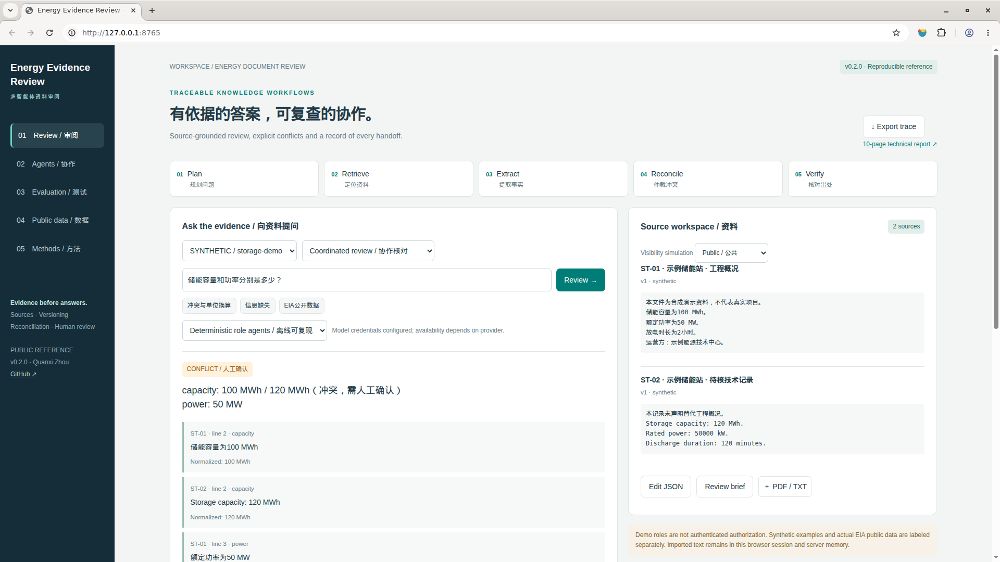

# Energy Evidence Review

**Traceable multi-role review for energy documents.** An independent reference implementation directed by Quanxi Zhou (GitHub: [SSCG3](https://github.com/SSCG3)), with AI-assisted code and documentation.

[中文说明](README.zh-CN.md) · [10-page English technical report](docs/technical-report.pdf) · [Architecture](docs/architecture.md) · [Data provenance](examples/public_sources/manifest.json) · [Actual results](results/comparison.json)



## What it does

A planner, retriever, extractor, reconciler, verifier and reporter exchange structured messages. Results retain quotations and source offsets, normalized units, explicit revision relations, unresolved conflicts and missing information. The optional model path adds **DeepSeek analyst → GLM reviewer → DeepSeek reporter**. Model notes remain separately labeled human-review drafts.

Two synthetic energy scenarios demonstrate document conflicts, equivalent units, revisions and visibility filtering. Actual EIA 2024 public electricity data for California, New York and Texas demonstrate attributed source ingestion. State generating capacity (MW) is explicitly distinguished from battery energy capacity (MWh).

## Quick start

Python 3.10+; the core uses the standard library only.

```sh
python3 server.py
# Open http://127.0.0.1:8765
python3 -m unittest discover -s tests -v
python3 evaluation/run_comparison.py
python3 evaluation/run_public_data.py
```

Optional PDF text-layer import:

```sh
python3 -m pip install -r requirements-pdf.txt
```

Select one project corpus, enter a question, inspect citations, generate a review brief or export its JSON journal. Upload PDF/TXT/MD or edit JSON. PDF import extracts its text layer, not images; unsupported or unrecognized facts may be missed. Review extracted text manually.

## Domestic model configuration

Only `deepseek/` and `z-ai/` (GLM) identifiers are accepted. Configure a compatible chat-completions endpoint in your shell; no `.env` file is loaded automatically.

```sh
export MODEL_BASE_URL=https://openrouter.ai/api/v1
export MODEL_NAME=deepseek/deepseek-v3.2
export MODEL_REVIEWER_NAME=z-ai/glm-4.7-flash
# Set MODEL_API_KEY locally without committing it.
python3 server.py
# Optional: python3 scripts/validate_models.py (3 scenarios / 9 completions)
```

See [live validation records](results/model-validation.json) for the actual outcome, model IDs, usage and response IDs. Mock role tests are labeled mocks. Errors never become successful offline model runs. Usage may incur provider charges. No credentials are bundled.

## Evaluation and scope

The 40 synthetic development cases compare first-hit retrieval, all-source retrieval with unit normalization, and coordinated review with revision handling. Actual results are 28/40, 36/40 and 40/40 respectively. On 12 EIA snapshot consistency checks, all three methods pass 12/12. These small, author-side fixtures are neither held out nor independent and do not establish superiority to production RAG. Expected labels stay outside engine inputs. The 0.1.0 results are preserved separately.

Eight supported field families use documented English/Chinese extraction patterns. This is not unrestricted natural-language understanding. Hash-linked journals detect changes within a supplied chain; they are not independently timestamped or immutable. Visibility selection is a local simulation, not enterprise authentication. The server binds to localhost and rejects missing request tokens and cross-origin writes.

## Layout

| Path | Purpose |
|---|---|
| `src/agents.py`, `engine.py`, `protocol.py` | Role agents, orchestration and hash-linked handoffs |
| `src/corpus.py`, `model.py` | Validated inputs/PDF text extraction and domestic model roles |
| `web/`, `server.py` | Local browser workbench and HTTP API |
| `examples/` | Synthetic corpora and attributed EIA snapshot |
| `evaluation/`, `tests/`, `results/` | Reproduction programs, invariant tests and actual outputs |
| `docs/`, `scripts/` | Report, screenshots, source mapping and support tools |

## Book and Jinshi context

Methods are mapped to the supplied multi-agent book manuscript in [book-method-mapping.md](docs/book-method-mapping.md). Publicly describable engineering patterns associated with the author's Jinshi experience motivate evidence tracing, permission boundaries and human review. No employer source code, private documents, corporate artwork or manuscript PDF are redistributed. This project is not a Jinshi release and inherits none of its operational metrics.

## Reuse, attribution and contribution

Original project code is MIT licensed. EIA material retains its attribution and applicable U.S. government reuse terms; see [THIRD_PARTY_NOTICES.md](THIRD_PARTY_NOTICES.md). No license is granted over book or employer materials. See [CONTRIBUTING.md](CONTRIBUTING.md) for reproduction reports. The initial implementation and report are AI-assisted under the author's direction; no independent adoption or expert endorsement is asserted. Public availability is a verifiable artifact, not a claim of field-wide impact.
