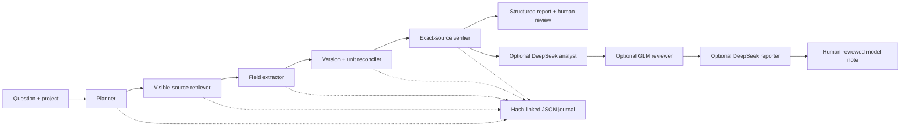

# Architecture and role boundaries

Role separation is implemented in Python classes, not merely UI labels. The coordinator restricts visibility before handing sources to extractors or optional model roles. Unit normalization never converts energy capacity into power or currencies into each other. Version precedence requires explicit input metadata. Revisions are applied per asserted field, preserving old fields not restated by the revision.

Offline roles do not use LLMs. The optional online path performs three real API exchanges with separate prompts and an independent review role, while retaining the deterministic evidence record. Different prompts or model families do not guarantee correctness. Reviewer objections and unsupported material require human review; model output never changes the underlying evidence decision.

See data-contract.md, tests/ and the 10-page report for limitations and exact test scope.
